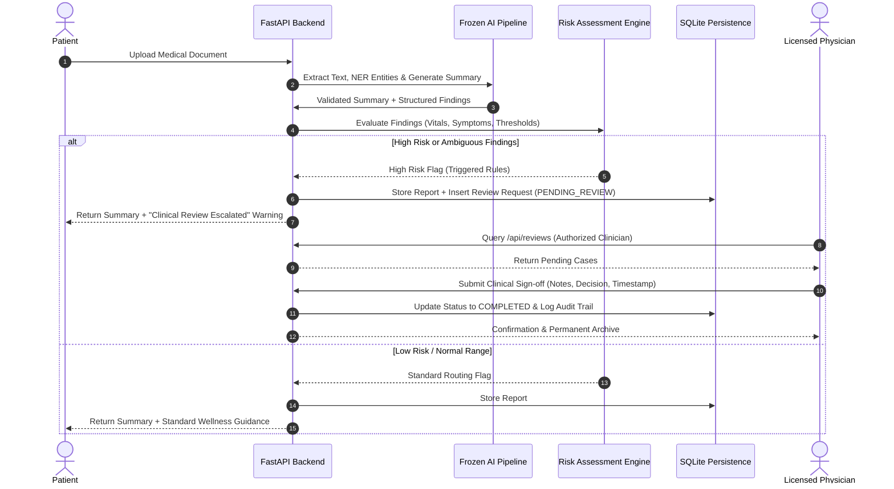

# MediGuide-AI: System Architecture & Engineering Specification

**AMD Developer Hackathon — ACT III: Health & Wellbeing**

---

## 1. Architectural Overview & Separation of Concerns

MediGuide-AI is built on a decoupled, safety-critical architecture designed to strictly isolate local machine learning inference from downstream persistence, security, and human-in-the-loop clinical review workflows.

```
                           +----------------------------------------+
                           |     Client Tier: React + Vite SPA      |
                           |   (Patient, Clinician, Admin Roles)    |
                           +----------------------------------------+
                                              |
                                              | HTTPS / JSON / Multipart
                                              v
                           +----------------------------------------+
                           |        FastAPI Backend Gateway         |
                           |   (Auth, RBAC, Schemas, CORS Guard)   |
                           +----------------------------------------+
                                    |                      |
            [Read-Only Frozen Boundary]                    |
                                    v                      v
        +-----------------------------------+   +------------------------------------+
        |      FROZEN AI INFERENCE TIER     |   |    DOWNSTREAM SAFETY & STORAGE     |
        | - Document Processing (PyMuPDF)   |   | - SQLite ACID DB (WAL Mode)        |
        | - OCR Engine (PaddleOCR)          |   | - PBKDF2 Password Hashing (100k)   |
        | - Biomedical NER (d4data)         |   | - HMAC-SHA256 Signed JWT Tokens    |
        | - DistilBART Summarizer (6-6)     |   | - Risk Engine & Human Escalation   |
        | - Metric Verification & Fallback  |   | - Clinical Review & Audit Logging  |
        +-----------------------------------+   +------------------------------------+
```

---

## 2. Frozen AI Pipeline Specification (Read-Only)

The extraction, entity recognition, summarization, and deterministic metric verification pipeline is permanently frozen:

| Pipeline Stage | Engine / Model | Purpose & Constraints |
| :--- | :--- | :--- |
| **Document Parsing** | PyMuPDF (`fitz`) | Fast, native text extraction from digital PDF documents. |
| **OCR Fallback** | PaddleOCR (Angle Classifier Enabled) | Fallback for scanned documents, smartphone photos, and image formats (`.png`, `.jpg`, `.jpeg`, `.bmp`, `.tiff`). |
| **Biomedical NER** | `d4data/biomedical-ner-all` | Sequence token classification identifying medical entities: Symptoms, Diagnostic Tests, Medications, Biological Metrics. |
| **Summarization** | `sshleifer/distilbart-cnn-6-6` | Clinical narrative condensation into plain, patient-accessible language. |
| **Verification Guardrail** | Deterministic Metric Comparator | Regex-based validation verifying that numerical test results (e.g., Blood Pressure, Heart Rate, Glucose) in the generated summary exactly match extracted findings. If validation detects discrepancy, it triggers a deterministic fallback template immediately. |

---

## 3. Downstream Persistence & Database Architecture

MediGuide-AI utilizes an embedded SQLite engine operating with **Write-Ahead Logging (WAL)** mode for concurrent, thread-safe access:

### Relational Schema

```sql
-- 1. User Accounts & RBAC
CREATE TABLE IF NOT EXISTS users (
    id TEXT PRIMARY KEY,
    name TEXT NOT NULL,
    email TEXT UNIQUE NOT NULL,
    password_hash TEXT NOT NULL,
    role TEXT NOT NULL CHECK(role IN ('patient', 'doctor', 'admin')),
    specialty TEXT,
    license_number TEXT,
    hospital TEXT,
    status TEXT NOT NULL DEFAULT 'Active' CHECK(status IN ('Active', 'Suspended')),
    created_at TIMESTAMP DEFAULT CURRENT_TIMESTAMP
);

-- 2. Patient Diagnostic Reports
CREATE TABLE IF NOT EXISTS reports (
    id TEXT PRIMARY KEY,
    user_id TEXT NOT NULL,
    filename TEXT NOT NULL,
    raw_text TEXT,
    summary TEXT NOT NULL,
    risk_level TEXT NOT NULL,
    is_high_risk INTEGER NOT NULL DEFAULT 0,
    risk_reasons TEXT,       -- JSON array
    entities TEXT,           -- JSON array
    measurements TEXT,       -- JSON array
    timings TEXT,            -- JSON object
    uploaded_at TIMESTAMP DEFAULT CURRENT_TIMESTAMP,
    FOREIGN KEY(user_id) REFERENCES users(id) ON DELETE CASCADE
);

-- 3. Human Clinical Review Requests
CREATE TABLE IF NOT EXISTS review_requests (
    id TEXT PRIMARY KEY,
    report_id TEXT,
    patient_id TEXT NOT NULL,
    risk_level TEXT NOT NULL,
    status TEXT NOT NULL CHECK(status IN ('PENDING_REVIEW', 'COMPLETED', 'ESCALATED')),
    summary TEXT NOT NULL,
    escalation_reasons TEXT, -- JSON array
    extracted_data TEXT,     -- JSON object
    decision TEXT,
    review_notes TEXT,
    reviewed_by TEXT,
    reviewed_at TIMESTAMP,
    created_at TIMESTAMP DEFAULT CURRENT_TIMESTAMP,
    FOREIGN KEY(report_id) REFERENCES reports(id) ON DELETE SET NULL
);

-- 4. Audit Log & Clinical Traceability
CREATE TABLE IF NOT EXISTS audit_logs (
    id INTEGER PRIMARY KEY AUTOINCREMENT,
    event_type TEXT NOT NULL,
    actor_id TEXT,
    target_id TEXT,
    details TEXT,            -- JSON object
    created_at TIMESTAMP DEFAULT CURRENT_TIMESTAMP
);
```

---

## 4. Security & Role-Based Access Control (RBAC)

### Password Security
- PBKDF2 with HMAC-SHA256, 100,000 hashing iterations, unique 16-byte random salt per user. Plaintext passwords are never stored or logged.

### Cryptographic Token Authorization
- JWT Bearer tokens signed with HMAC-SHA256 (`MEDIGUIDE_SECRET_KEY`).
- Token payload embeds user ID, email, role, and expiration timestamp.
- Server-side dependency `require_role(["patient" | "doctor" | "admin"])` verifies signatures and claims on every protected API call.

### Patient Data Isolation
- Standard patients querying `GET /api/reports` only receive reports where `user_id == authenticated_user_id`.
- Accessing another patient's report via `GET /api/reports/{id}` directly triggers HTTP 403 Forbidden.
- Doctors and Administrators have role-based authorization to inspect cases routed to the clinical escalation queue.

---

## 5. Human-in-the-Loop Clinical Escalation Workflow



---

## 6. Frontend Architecture (React 19 + Vite)

- **Routing & Authentication**: `react-router-dom` with `AuthContext` managing JWT token persistence in `localStorage`, automatic Bearer header attachment via `apiFetch`, and graceful session handling.
- **Dynamic Risk Presentation**: Visual risk badges clearly distinguish `High Risk` from `Standard Report`, guaranteeing safety flags are never discarded.
- **Empty States & Truthful Findings**: Missing measurements or clinical categories display explicit "None detected" / "None listed" empty states rather than placeholders.
- **Appointment Organizer**: `AppointmentPrep` enables patients to curate customized questions and checklists for their physician consultation based on extracted lab data.

---

## 7. Multilingual Architecture & Medical Safety Guardrails

MediGuide-AI implements end-to-end multilingual capability across English and 5 major Indian languages (Tamil, Hindi, Telugu, Malayalam, Kannada) while preserving the frozen clinical AI pipeline:

```
+-----------------------------------------------------------------------------------+
|                            CLIENT TIER: REACT 19 SPA                              |
|  - LanguageContext: Global reactive state, dot-notation resolver & fallback       |
|  - LanguageSelector: Native script labels (தமிழ், हिन्दी, తెలుగు, മലയാളം, ಕನ್ನಡ) |
|  - Patient Dashboard, Upload, Report Analysis, Assistant, Appointment Prep        |
+-----------------------------------------------------------------------------------+
                                         |
                       REST API (Bearer JWT + Language Headers)
                                         v
+-----------------------------------------------------------------------------------+
|                             FASTAPI GATEWAY ROUTERS                               |
|  - GET /api/languages                -> Returns supported codes & native names    |
|  - PATCH /api/auth/language          -> Updates & persists user preference in DB  |
|  - GET /api/reports/{id}?lang=...    -> Returns localized explanation without DB  |
|                                         record corruption                         |
|  - POST /api/reports/{id}/translate  -> Dynamic on-demand explanation translation |
|  - POST /api/process-text            -> Multilingual conversational AI agent      |
+-----------------------------------------------------------------------------------+
                                         |
                                         v
+-----------------------------------------------------------------------------------+
|                        TRANSLATION & AGENT TIER (LOCAL)                           |
|  - Unicode Script Classifier: Detects Tamil, Devanagari, Telugu, Malayalam,       |
|    Kannada character blocks deterministically (zero external API calls).          |
|  - Clinical Metric Preservation Engine: Protects measurements (e.g. 130/85, 12.5),|
|    units (mmHg, g/dL), medication names (Aspirin), and dates from corruption.     |
|  - Multilingual Emergency Triage: Detects life-threatening symptoms in any script |
|    (e.g., "நெஞ்சு வலி", "सीने में दर्द") and triggers immediate escalation.      |
+-----------------------------------------------------------------------------------+
                                         |
                                         v
+-----------------------------------------------------------------------------------+
|                         PERSISTENT STORAGE: SQLITE ACID                           |
|  - users table: preferred_language TEXT DEFAULT 'en' (schema migration in WAL)    |
|  - reports table: original extracted text, findings, and metrics saved verbatim   |
+-----------------------------------------------------------------------------------+
```

### Safety Principles for Medical Translation
1. **Zero External API Dependencies**: Translation runs entirely on-premise without third-party cloud translation keys or paid cloud APIs, guaranteeing patient data privacy.
2. **Measurement & Unit Immutability**: All numerical values (`130/85`, `12.5`, `98.6`), laboratory units (`mmHg`, `g/dL`, `mg/dL`, `mmol/L`), and drug names are locked and preserved verbatim.
3. **Non-Destructive Storage**: Database records retain the original extracted text and raw biomedical entities; translations are computed and served on demand.
4. **Mandatory Clinical Disclaimers**: Disclaimers emphasizing educational guidance and physician consultation are provided in the patient's selected language.

